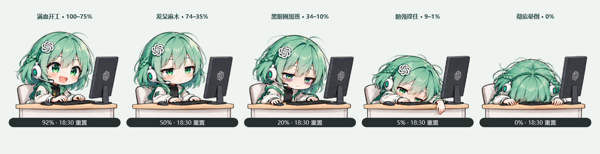
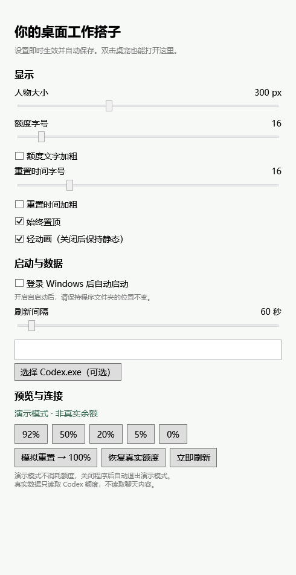

# ChatGPT Desktop Pet · ChatGPT 桌面宠物

**目前仅提供 Windows 版本。macOS（Mac）版本将在后续开发，具体发布时间待定。**

一个在电脑前陪你工作的 Windows 桌宠：用五种精神状态，直观显示 **ChatGPT 登录的 Codex 五小时剩余额度和重置时间**。

> 当前为 v0.1 预览版。此处的额度是 Codex 五小时使用窗口，不是 ChatGPT 网页聊天消息余额。本项目非 OpenAI 官方产品。



*以上为程序渲染的演示数据，非个人真实额度。*

## 功能

- 显示五小时剩余百分比、重置时间，悬停查看倒计时。
- 五种人物姿态随额度切换，支持轻微呼吸、点头、键盘微光等动画。
- 拖动位置并自动记忆；可选始终置顶。
- 人物大小、额度文字和时间文字的字号/粗细可独立调整。
- 隐藏到 **Windows 系统托盘区**，后台继续刷新。
- 可选开机自启动，默认关闭。
- 内置五状态演示，方便查看外观；可随时恢复真实额度。

## 运行效果


底部显示剩余额度和本机时区的重置时间。正常连接时不显示额外标题；演示或连接异常时会显示状态提示。

| 剩余额度 | 人物状态 |
| --- | --- |
| 100%–75% | 满血开工 |
| 74%–35% | 发呆麻木 |
| 34%–10% | 黑眼圈疲惫 |
| 9%–1% | 更疲惫，勉强撑住 |
| 0% | 正脸朝下趴桌，彻底晕倒 |

正数余额向上取整，只有实际耗尽才显示 0%。重置到点后重新查询服务端，不直接假定恢复到 100%。

## 快速开始

1. 准备 Windows 10/11 x64、.NET Framework 4.8，以及已通过 ChatGPT 登录的本机 Codex。
2. 下载项目提供的 `ChatGPTPet-v0.1-win-x64.zip` 便携包并完整解压到可写目录。
3. 双击 `ChatGPTPet.exe`，保留旁边的 `assets` 文件夹和配置文件。
4. 首次读取后显示真实额度。若未发现 Codex，可在设置中指定 `codex.exe` 路径。

这是原生 EXE 便携程序，无需浏览器或开发者工具。当前预览版未做代码签名。

## 操作与设置



- **移动**：拖住人物或额度条。
- **设置**：双击人物，或使用右键菜单。
- **隐藏/恢复**：隐藏到系统托盘；双击托盘图标恢复，再次运行 EXE 也会恢复已有窗口。
- **退出**：使用托盘菜单中的“退出”。
- **演示**：92 / 50 / 20 / 5 / 0 按钮预览五种状态；100% 模拟恢复满额。点击“恢复真实额度”结束演示，重启也会退出演示。
- **自启动**：设置中开启后随当前用户登录 Windows 启动。移动程序目录后需重新关闭再开启；删除程序前先关闭。

设置保存在程序旁的 `data/settings.json`。请不要把程序放在没有写入权限的目录。

## 额度来源与隐私

通过本机 `codex app-server` 的 `account/rateLimits/read` 读取 `codex` 额度桶中的 300 分钟窗口，默认每 60 秒刷新。每次查询临时启动无控制台子进程，读取后释放。查询不创建模型任务，不读取聊天内容，应用不复制登录令牌。

连接失败时保留本次运行的上次有效结果，并标记未更新；首次没有数据时显示 `--%`。登录错误、网络错误、缺失字段或未知窗口不会被当成额度耗尽。个人设置和真实额度探测报告不纳入发布内容。

## 本地构建与检查

使用 C# / WPF 和 Windows .NET Framework 编译器，不需要 .NET SDK 或 NuGet 包。

```powershell
powershell -ExecutionPolicy Bypass -File .\build.ps1
.\dist\ChatGPTPet.exe --self-test .\tests\test-report.txt
.\dist\ChatGPTPet.exe --render-preview .\docs\images
```

构建产物位于 `dist`。可用 `--probe <报告路径>` 只读检查真实连接；报告可能含个人额度，请勿提交。已有 32 项检查覆盖状态边界、异常数据、设置和窗口行为。

## 当前限制

- 仅支持 Windows x64 和 Codex 五小时额度；不含周额度、Token 统计或 WorkBuddy。
- 动画是姿态图的局部变化和轻量特效，尚非逐帧眨眼、手指打字或骨骼动画。
- 不含安装器、自动更新。独占全屏与系统安全桌面不保证被置顶覆盖；混合 DPI 多屏需要更多实机验证。
- 依赖本机 Codex 的额度接口，接口变化时可能需要更新程序。

## 素材与灵感

灵感来自 [crosspet-codex-usage](https://github.com/SUXS-sudo/crosspet-codex-usage)。本项目聚焦单一额度窗口，采用独立的 C# / WPF 实现。

人物图集由 AI 根据本项目确认的设计生成，来源记录见 [素材说明](assets/PROVENANCE.md)。ChatGPT、Codex 等名称属于其各自权利人。
